## One question, a dozen answers {.smaller}

NoSQL is not a family of products. It is a family of **answers to one
question**: *where is the commit point, and who pays for it?*

| where the commit point is | the system | what it charges |
|---|---|---|
| one node | Postgres | horizontal write scale |
| nowhere: converge later | CouchDB, Riak | conflicts to reconcile |
| a dial you turn per query | Cassandra | joins, cross-partition work |
| a majority, every commit | HBase, YugabyteDB, TiDB | latency |
| gone: no promise made | memcached | the value may not be there |

Every system in this lecture is one of those five answers, and every one of
them is software you can download and read. That last part is not a neutral
fact about the software market, and slide 41 comes back to it.

::: {.notes}
Say the question out loud, then say that the rest of the lecture is a tour of
the answers. If they hold the question, the systems stop being a list.

The reading clause is a promise the deck pays off late, on the licence slide.
Mention it now so the last part lands as an answer rather than a rant.
:::

# Part 0 — The Promise

## A commit point is one decision, made once {.smaller}

The problem

> A commit point is the single instant at which a set of writes becomes,
> together, **visible**, **durable** and **ordered** — and there is exactly one
> of them per transaction.

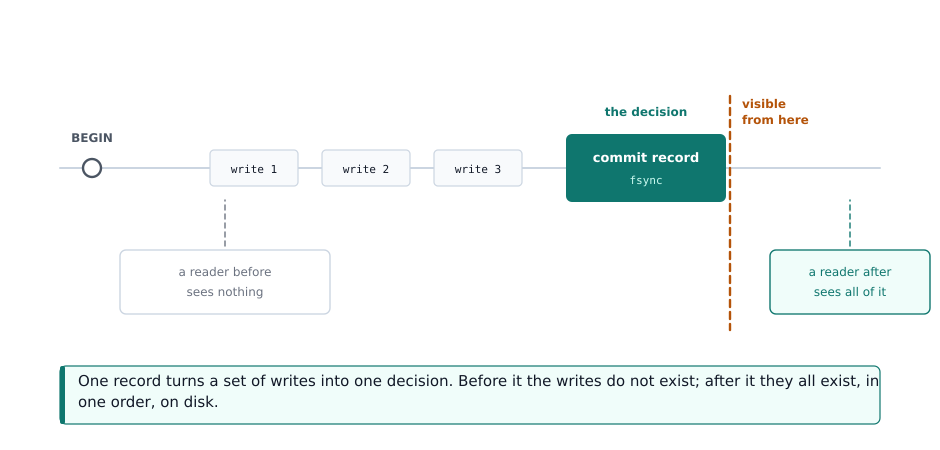{width="88%"}

In Postgres you can point at it. `COMMIT` appends a commit record to the
write-ahead log and fsyncs it. Before that record exists, no reader sees
anything. After it, every reader sees all of it.

::: {.notes}
Slow down here; this is the definition the rest of the hour leans on. If they
leave with one sentence, it should be this box.

The point to make physically: the commit point is not the node and not the
table. It is one record, in one file, on one disk. Everything else in the
lecture is an attempt to have that record in more than one place.
:::

## Having it twice is the problem {.smaller}

The problem

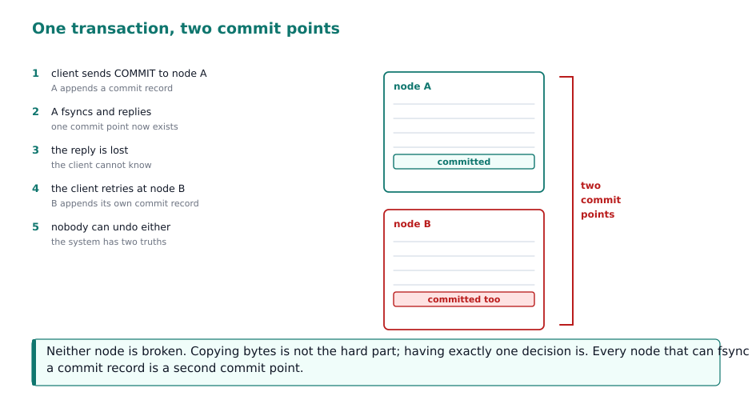{width="88%"}

Durability on many machines is easy — copy the bytes. What is hard is **one
decision out of many independent ones**.

Neither node is broken. Each one did exactly what it was asked. The system now
has **two truths and no undo**.

That is the challenge, and it is not storage or throughput: it is a single
decision, made once, when the deciders cannot see each other.

::: {.notes}
This is the slide that turns "commit point" from a phrase into a problem. The
retry is the ordinary case — a lost reply is not exotic, it is Tuesday.

Ask the room what should have happened. Every answer is a coordination cost:
the client checks before retrying, or A and B agree who owns the key, or the
transaction carries an id both nodes can deduplicate on.
:::

## A transaction is the unit these promises are about {.smaller}

The mechanism

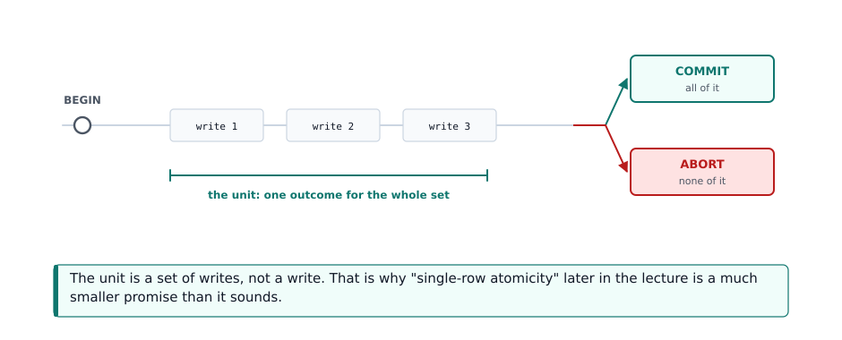{width="82%"}

`BEGIN`, statements, then `COMMIT` or `ABORT`. The unit is **a set of writes
with one outcome**, not a write.

Worth saying early, because the rest of the lecture keeps using it: a
single-row write is a transaction of size one. "Single-row atomicity" is a much
smaller promise than "atomicity" sounds, and the difference matters in Part III.

::: {.notes}
If anyone has written `BEGIN; ...; COMMIT;` this is revision rather than new
material, which is fine — the point is that the *unit* is the set, and every
guarantee in the next slide is a guarantee about the set.

The aside about single-row atomicity pays off on the Cassandra slide, where
atomicity is real but scoped to one partition.
:::

## ACID is four promises about one transaction {.smaller}

The mechanism

| | the promise | a property of |
|---|---|---|
| **A** | the whole set lands, or none of it does | the mechanism |
| **I** | concurrent transactions do not see each other's uncommitted work | the mechanism |
| **D** | once the commit record is on disk, a crash does not undo it | the mechanism |
| **C** | the transaction moves the data from one valid state to another | **the data model** |

Read the first three with the word "transaction" in front: the transaction is
atomic, isolated and durable. **C is different**: it is a statement about
*invariants you declared* — keys, foreign keys, checks.

It only means anything if something declared them. Park that; it is all of
Part IV.

::: {.notes}
The question to plant: which of these four needs to know what your data means?
A, I and D need to know about writes. C needs to know about the schema.

That distinction is why a system can be careful about the first three and have
nothing to say about the fourth — which is exactly what Cassandra will do.
:::

## Write-ahead logging is how one node keeps all four {.smaller}

The mechanism

The mechanism is old and unglamorous: **append the intent, then apply it
later**.

1. append the new values to the log
2. `fsync` the log — this is the commit record
3. apply to the data pages at leisure, in log order
4. after a crash, replay the log from the last checkpoint

| the log is | because |
|---|---|
| the **order** | pages are updated in log order, and only in that order |
| the **durability record** | the commit record is on disk before the client hears yes |
| the **recovery plan** | replay is the repair, and it needs no coordination |

One artifact does all three jobs. That is why a single node gets A, I and D
almost for free — and why the commit record *is* the commit point.

::: {.notes}
This is the review the lecture needs before it can remove anything. If the log
is not concrete, "distributing the commit point" is a slogan.

The deep point: the log is a *total order of writes* that one process wrote.
Distribution means many processes each writing their own total order, and no
way to interleave them.
:::

# Part I — Why It Does Not Distribute

## Two writers, two orders, one row {.smaller}

The problem

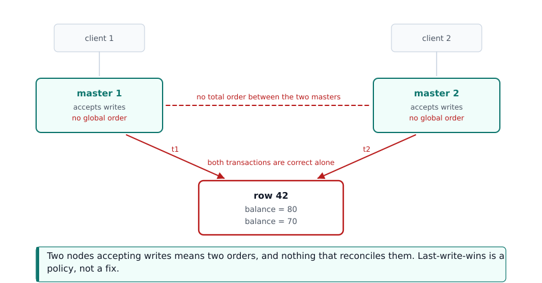{width="86%"}

Let more than one node accept writes and you immediately get **conflicting
concurrent transactions**: two inserts on one key, two updates to one row, two
transactions that each assume they are the only writer.

Last-write-wins is not a fix. It is a policy for choosing which write to throw
away, and it has to be chosen per column, by somebody, before the first
conflict arrives.

::: {.notes}
The key phrase is "each assume they are the only writer". Isolation is the
promise that this assumption is safe, and it is a promise one node can keep.

Ask the room what a bank does here. The answer is not "pick a winner" — it is
"never allow the situation", which is a coordination cost.
:::

## The only fix is coordination, and it costs latency or availability {.smaller}

The trade

::: {.columns}
::: {.column width="50%"}
**Eager: agree before committing**

- distributed locking, or consensus (Paxos, Raft)
- synchronous replication to a quorum
- correct, and it pays a round trip on every commit
- loses availability when the network does
:::

::: {.column width="50%"}
**Lazy: commit locally, replicate later**

- fast, and available during a partition
- replicas diverge during normal operation
- conflicts and stale reads become possible
- this is not ACID any more
:::
:::

> Maintaining ACID across multi-master replication is "virtually impossible"
> with any semblance of performance.

**ACID is not hard because Postgres is old. It is hard because one global
commit point does not scale across writers without paying for coordination.**

::: {.notes}
The quote is the Postgres community's, and it is worth saying who said it: the
people with the most to gain from being wrong.

Note the shape of the argument: it is not that distributed ACID is impossible,
it is that it costs something specific. Part VI shows the systems that pay it.
:::

## The fork: converge later, or wait for a majority {.smaller}

The trade

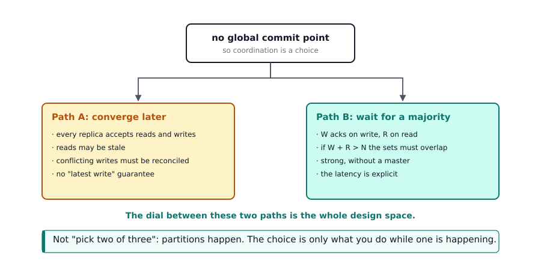{width="82%"}

Path A gives up "the latest write". Path B gives up "the fast write". There is
no third path — only different prices for the same two.

::: {.notes}
If they take one vocabulary word from the lecture, make it this fork. The next
two slides give it its formal name and then take the name apart.

Note that both paths still replicate. The difference is what a *read* is
allowed to see.
:::

## CAP is about what you do during a partition {.smaller}

The trade

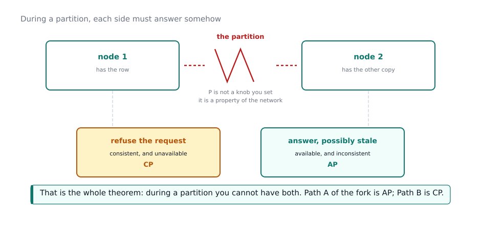{width="82%"}

| | the guarantee | what it means here |
|---|---|---|
| **C** | linearizability | every read returns the latest completed write |
| **A** | availability | every request gets a non-error response |
| **P** | partition tolerance | not a knob: a property of the network |

So "pick two of three" is the wrong sentence. **P was never optional.** The
choice is only what you do *while* a partition is happening — which is the fork
from the previous slide, now with its formal name: **Path A is AP, Path B is
CP.**

::: {.notes}
The theorem is Gilbert and Lynch formalising Brewer, and it is worth saying that
it is about a *specific* consistency model, which the next slide takes apart.

Do not let "pick two" survive the slide. The correction is the point: partitions
are not a design choice, so the only choice is the response.
:::

## CAP's C is not ACID's C {.smaller}

The trade

The shared letter is a coincidence of vocabulary, and it is the most misread
coincidence in the field.

| | what it actually is | about |
|---|---|---|
| **CAP's C** | linearizability | one operation, in real time |
| **ACID's C** | declared invariants hold | the whole data set |
| **ACID's I** | isolation; serializable at its strongest | one transaction |

Serializability is not linearizability. Together they are **strict
serializability**, which is what the systems in Part VI actually aim at.

Which gives the sharp result: **a system can be CP and still violate ACID's
C** — because ACID's C needs invariants to exist and machinery to check them.
CAP constrains replication during a partition. ACID constrains what a
transaction promises. Different questions.

::: {.notes}
This is the slide that stops a whole family of confused sentences, so give it
time. "Mongo is CP so it's ACID" is the kind of thing that falls out of it.

The precise version: CAP is about a register, ACID is about a transaction over
several objects, and neither one implies the other.
:::

## R + W > N is the whole dial {.smaller}

The mechanism

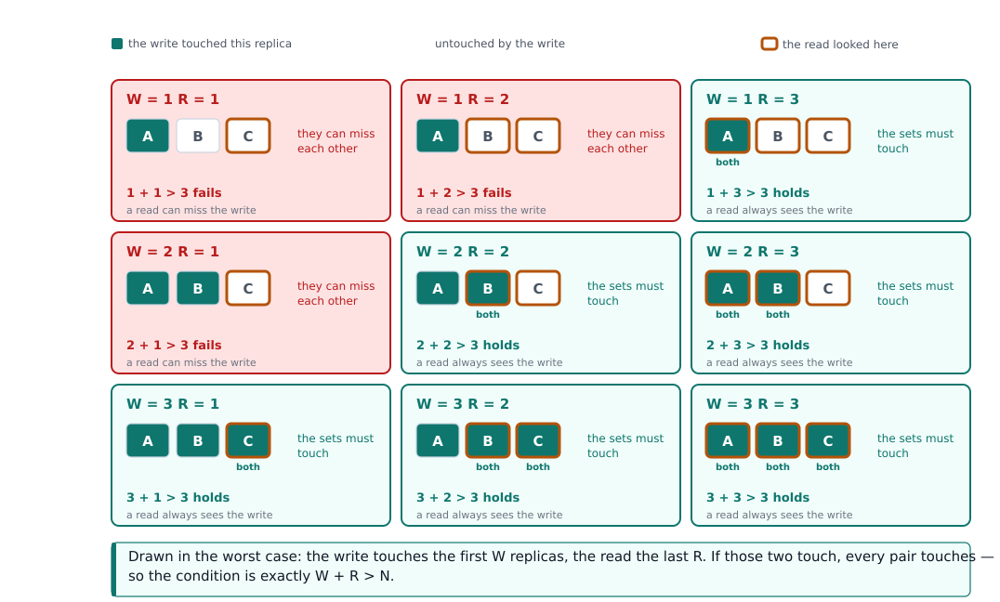{width="92%"}

With **N** copies, require **W** acknowledgements to write and **R** replicas
to read. If **W + R > N**, the write set and the read set cannot miss each
other, so every read touches at least one replica holding the latest write.

Six of the nine settings work. The other three are not broken — they are Path A
with extra steps.

::: {.notes}
This is the slide to do slowly, because it is the one piece of arithmetic in
the lecture that a student can check on their fingers.

Do two cells out loud: W=2, R=2 overlaps; W=1, R=1 does not. Then ask what
W=3, R=1 costs — it is the slowest write and the fastest read, and it is the
setting nobody chooses.
:::

# Part II — Sharding

## Sharding answers a different question: who owns this key {.smaller}

The problem

Replication copies the same rows. **Sharding splits them**: a key function
decides which node owns which rows, so capacity and write throughput grow with
the number of machines.

It does not make anything consistent. It makes a *different* problem: every
question that used to span the table now spans the network.

::: {.notes}
Be clear that this is orthogonal to the fork. You can shard and still be ACID
(that is what Part VI does); you can replicate and never shard.

The reason sharding appears here is that it is what makes the join expensive,
and the join is the next slide.
:::

## The join is the casualty, and it takes ACID's C with it {.smaller}

The bill

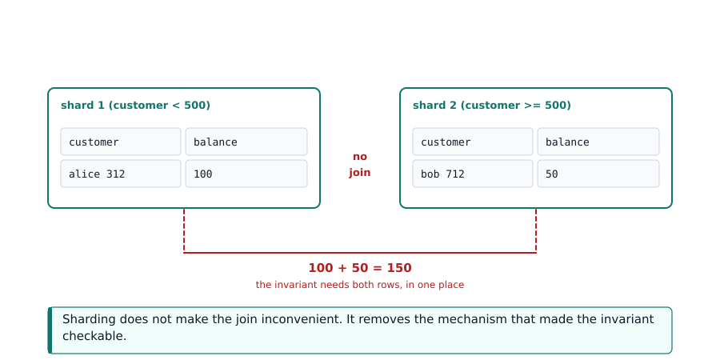{width="82%"}

An invariant that spans two entities needs both entities **in one place**, at
the same moment, with a decision about both. Shard the rows apart and you have
removed the place.

This is the hinge of the lecture: **losing the join is not a convenience loss.
It is the loss of the mechanism that made "C" checkable.**

::: {.notes}
Say it twice. Students file "no joins" under inconvenience, next to "no
stored procedures", and it is not that.

Once this is on the board, the precision beat in Part IV is almost forced: if
you removed the enforcement machinery, then "consistency" has to mean something
else, and the next question is what.
:::

## How would you fix it? {.smaller}

The bill

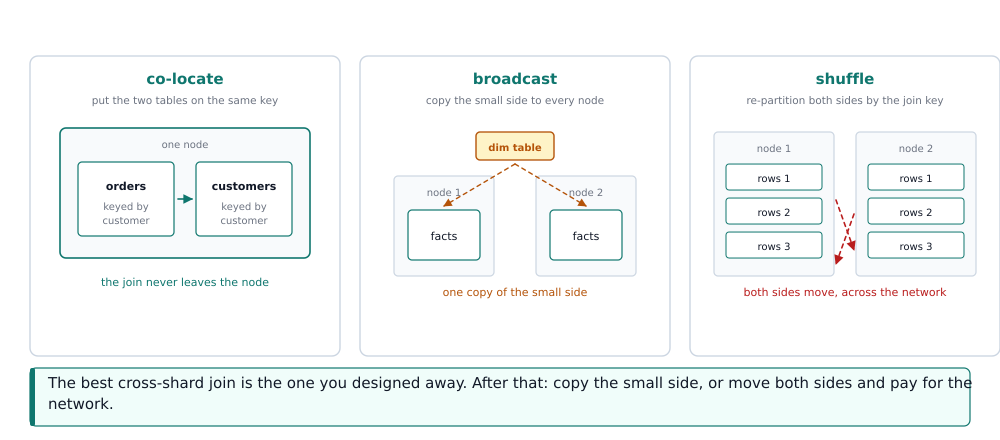{width="92%"}

Four answers, and only the first is cheap:

| answer | when you pay | what it does |
|---|---|---|
| **co-locate** | design time | shard both tables on the join key |
| **denormalize** | write time | store the answer, so no join happens |
| **broadcast** | query time | copy the small side to every node |
| **shuffle** | query time | re-partition both sides by the join key |

A query optimizer chooses between the last two. A designer chooses the first
once, and gets one chance to choose the shard key. Denormalizing is Cassandra's
answer, and it is the next part.

**The best cross-shard join is the one you designed away.**

::: {.notes}
The reason this slide is here rather than in a later part: it answers the
question the previous slide raises, so the room does not sit with it.

The honest ranking is design-time, write-time, query-time — cheapest first. If
you cannot co-locate, you are choosing which of the other three bills to pay,
and the optimizer will choose per query.
:::

# Part III — Cassandra, the AP Answer

## Cassandra is what you build when you accept the trade {.smaller}

The promise

Cassandra is leaderless, partitioned and replicated, and it **refuses
cross-partition coordination by design**: no distributed joins, no
cross-partition transactions, no foreign keys.

| it gives you | it charges you |
|---|---|
| linear write scaling | no joins, ever |
| a per-query consistency dial | no cross-partition transactions |
| no single point of failure | no ad-hoc queries: the table is the query |

That is the whole bargain. Everything after this is Cassandra living with it.

::: {.notes}
"Refuses by design" is the phrase to keep. This is not a system that forgot to
add joins; it is a system that removed the machinery joins need, so that it
could keep scaling writes.

The next eight slides are all consequences of that one decision.
:::

## It is a table, but not the table you mean {.smaller}

The mechanism

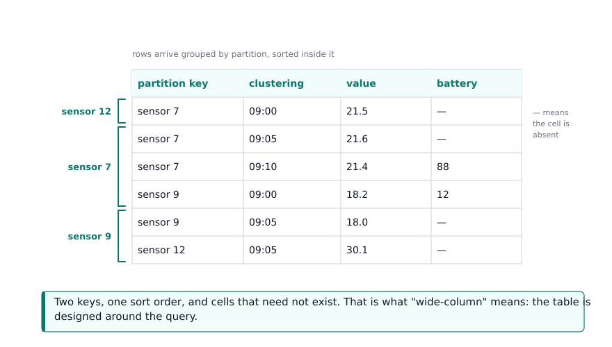{width="88%"}

Not a document store with columns instead of JSON, and not a blob store. It is
a **partition-addressed, sorted, wide-column engine**: a two-dimensional
key-value store.

- the **partition key** decides which node owns the row
- inside a partition, rows are ordered by the **clustering columns**
- cells are **sparse** — different rows may hold different columns

**You design the table around the query, not the entity.**

::: {.notes}
The sparseness is what "wide-column" means, and it is why the model came from
Bigtable rather than from SQL. Point at the dashes: those cells do not exist,
they are not null.

The last line is the same discipline as a materialized view, and it is worth
saying that here — slide 34 comes back to it.
:::

## Writes are cheap because the log is the table {.smaller}

The mechanism

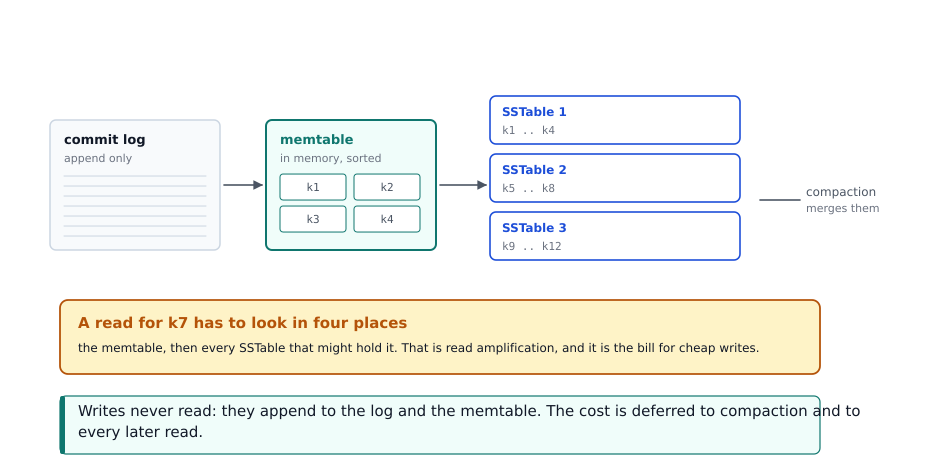{width="92%"}

A write appends to the commit log and to an in-memory **memtable**, and is
acknowledged. The memtable flushes to an immutable **SSTable**; compaction
merges them in the background.

Nothing is read before it is written. The bill arrives later: a read for one
key may have to look in four places before compaction, and compaction itself
steals I/O from the foreground.

::: {.notes}
This is the shape that makes linear write scaling possible: no read, no lock,
no random write in place.

The honest cost: a read may have to check several SSTables, and compaction
steals I/O from the foreground. Both are tunable, neither is free.
:::

## Two axes, and neither is the other {.smaller}

The mechanism

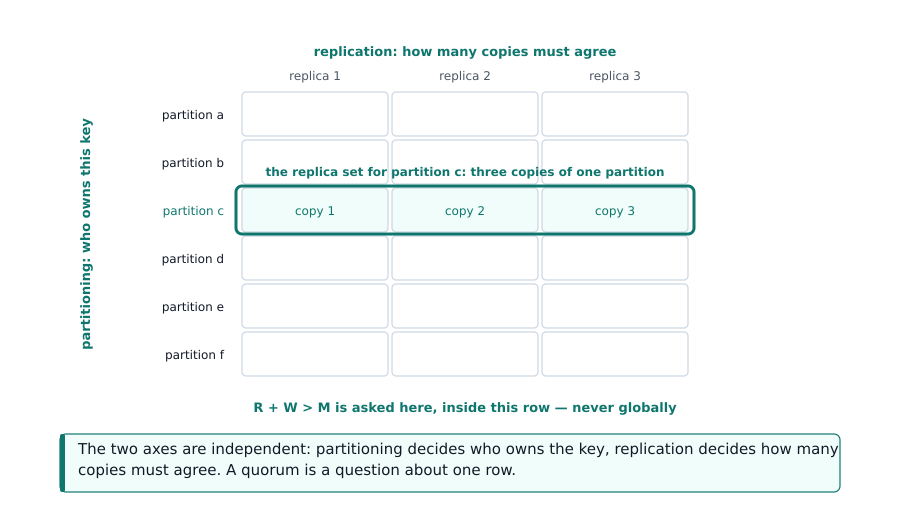{width="86%"}

**Partitioning** decides who owns the key. **Replication** decides how many
copies exist and how many must agree. The quorum question, `R + W > M`, is
asked *inside one replica set* — never globally.

Say "**many partitions, each replicated M times**". The number of partitions is
a function of your data, not a setting.

::: {.notes}
The precision matters: "N partitions" is the sentence that makes people think
the partition count is fixed. It is not — the token ring mapping is what is
fixed, and the count grows with the data.

Failure handling splits along these same two axes, which is the next slide.
:::

## Consistency is a value the client passes per query {.smaller}

The mechanism

| level | what the coordinator waits for | when you would choose it |
|---|---|---|
| `ONE` | one replica | speed, and you can live with staleness |
| `QUORUM` | a majority of replicas | the default answer for strong reads |
| `ALL` | every replica | almost never: one dead node stops you |
| `LOCAL_QUORUM` | a majority in this datacenter | multi-region, without cross-region waits |

The dial is **per operation**, set by the client. The same table can be read
strongly for a checkout and weakly for a dashboard.

::: {.notes}
This is the fork from slide 8, sold as an API. Note that the client has to know
which read needs which guarantee — that is real application work, and it is
part of the bill.

`LOCAL_QUORUM` is the setting that makes multi-datacenter deployments work: you
get a majority where the latency is small.
:::

## The same architecture, two philosophies {.smaller}

The trade

| | Dynamo-style | Raft-style |
|---|---|---|
| who chooses the quorum | the client, per query | the system, per shard |
| examples | Cassandra, Riak | HBase, YugabyteDB, TiDB |
| what it buys | tunable latency | one isolation level, always |
| what it charges | you must know each query's needs | coordination on every commit |

Same two axes — partitioning and replication. The difference is whether the
trade is **a runtime dial** or **a design-time commitment**.

::: {.notes}
This slide is the bridge to Part VI, so flag it as one. Everything up to here
has been the dial; the last part of the lecture is the systems that refuse to
have one.

Ask which they would rather operate. The honest answer is that it depends on
whether your read patterns are stable enough to make the choice once.
:::

## A dead replica is a replica-group problem {.smaller}

The mechanism

::: {.steps style="height:520px"}

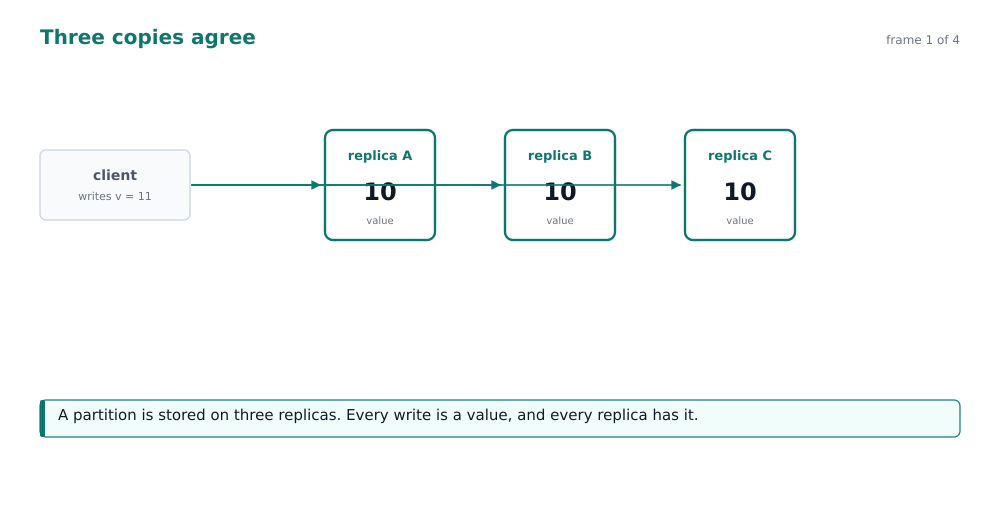

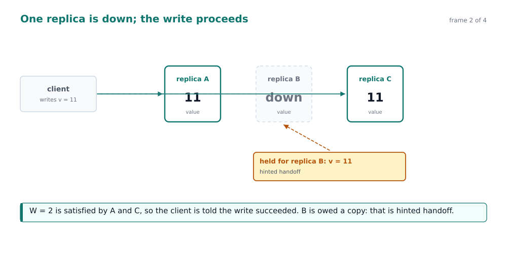{.fragment}

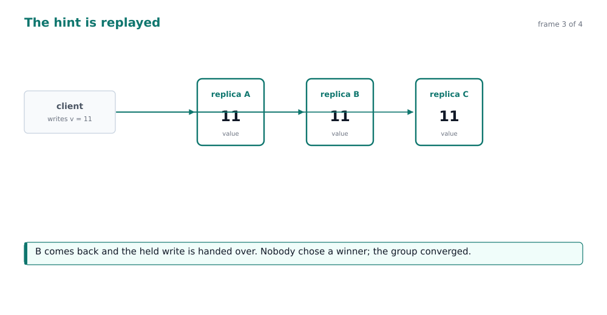{.fragment}

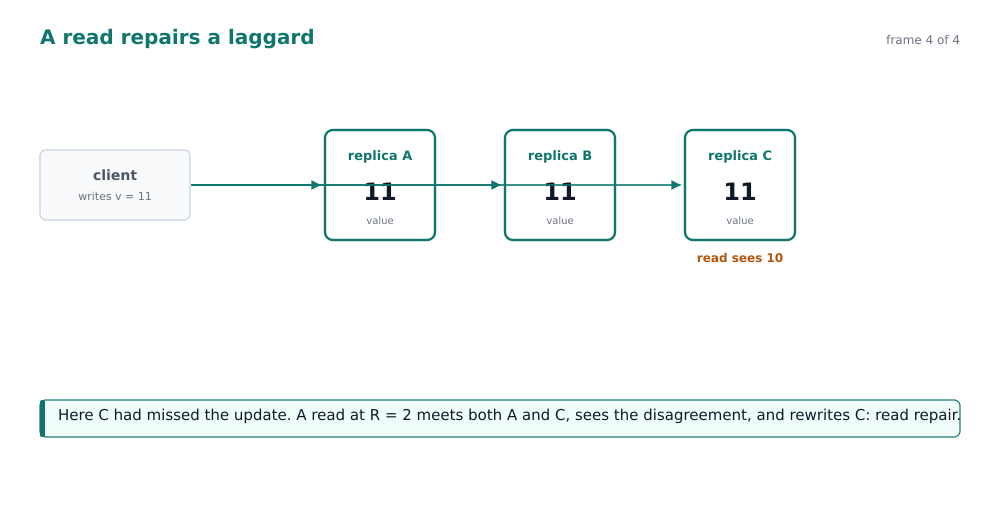{.fragment}

:::

Three mechanisms, one idea: **the group converges without a global decision.**
Hinted handoff covers a dead node, read repair fixes a laggard on the read path,
and anti-entropy repair compares the whole set in the background.

::: {.notes}
Click through the four frames. The thing to notice is that nobody ever says
"this replica wins" — there is no election, only arithmetic and a repair.

The last frame is the one that matters: a read is allowed to *fix* a replica.
That is why `QUORUM` reads are stronger than they look.
:::

## Three transaction mechanisms, none of them general {.smaller}

The mechanism

| mechanism | scope | atomic | isolated | what it costs |
|---|---|---|---|---|
| logged batch | one partition | yes | **no** | all statements must share a partition key |
| lightweight transaction | one partition | yes | yes, one row | four round trips, and no batches |
| Accord | many partitions | yes | yes | newer, and a layer on top of the design |

A batch is atomic but not isolated: concurrent operations interleave. A
lightweight transaction is isolated but cannot be combined with a batch,
because its isolation requirement is exactly what a batch does not provide.

::: {.notes}
The pattern to name is the one everybody writes: read, check, then batch —
accepting a race window between the two.

Accord is worth one sentence, not more: the fact that general transactions
arrived as an *opt-in layer* rather than a rewrite is the interesting part.
Verify its current status before you cite it.
:::

## There are no joins, only denormalized tables {.smaller}

The bill

> You cannot perform joins in Cassandra. If you have designed a data model and
> find that you need something like a join, you'll have to either do the work
> on the client side, or create a denormalized second table that represents the
> join results for you.

That is the official position, and it is not a limitation to be worked around.
It is the fourth answer from slide 17 — **denormalize** — taken as the default:
one table per query pattern, with the data duplicated so that every query is a
single-partition read.

The bill is redundancy and write amplification. The payment buys you this: no
query ever coordinates across nodes.

::: {.notes}
Read the quote out loud; it is unusually direct for vendor documentation.

Then the engineering point: denormalization is not sloppiness here, it is the
schema design. The redundancy is the price of the single-partition read, and it
is paid at write time.
:::

## The transfer it cannot do {.smaller}

The evidence

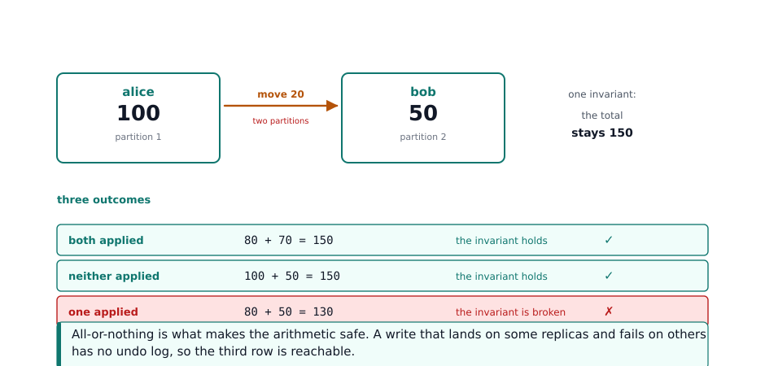{width="90%"}

Two accounts, two partitions, one invariant: the total does not change.
`100 + 50 = 150` before, `80 + 70 = 150` after — and `80 + 50 = 130` is a row
this system can produce.

The third row is reachable. If a write succeeds on some replicas and fails on
others at `QUORUM`, the client is told it failed — and **nothing undoes the
replicas that succeeded**. There is no cluster-spanning undo log to undo it
with.

::: {.notes}
This is the concrete instance the whole of Part IV points back at, so give it
time. Ask them to find the row where the money disappeared.

The subtle part: the client is told the write failed, and it *did* fail, and
the data is still wrong. Failure and inconsistency are not the same event.
:::

## How it fails each letter {.smaller}

The bill

| letter | at what scope | what it actually offers |
|---|---|---|
| **A** | one partition | a single row, or one batch, is all-or-nothing |
| **I** | one row | no reader sees a half-written row; nothing else is isolated |
| **D** | one replica | the local write survives a crash; there is no cluster-wide commit |
| **C** | — | **declined**: no cross-partition invariants, so nothing to enforce |

Not uniform across the four letters. Three of them are delivered at a scope
much smaller than the word suggests, and the fourth is not delivered at all.

::: {.notes}
This table is the deck's answer to "so is Cassandra ACID or not?", and the
answer is "which letter, at what scope". That is the habit the next part turns
into an argument.

The durability row is the one that surprises people: durable, but of a local
write, not of a committed transaction.
:::

# Part IV — The Precision Beat

## "Partially ACID" is not a category {.smaller}

The claim

ACID is a property of **a transaction**. A transaction satisfies the set or it
does not. There is no 50% transaction, and no formal object called "partially
ACID".

What Cassandra offers is a **specific subset of guarantees**:

- partition-level atomicity
- row-level isolation
- local (per-replica) durability
- and an explicit refusal of the global "C"

That is a precise claim about four separate things. "Partially ACID" is a
sentence that sounds like one thing.

::: {.notes}
This is the strongest intellectual moment in the lecture, so give it the screen
time. The move is from a fuzzy adjective to a list.

If someone objects that "partially ACID" is common usage: yes, and it is the
kind of usage that hides which guarantee you actually have.
:::

## ACID never required relations {.smaller}

The claim

The first misconception to clear: ACID is not a relational feature.

- **A**, **I** and **D** are properties of a write mechanism. They do not know
  what your data means, and they do not need a schema.
- There is no contradiction in a non-relational system providing some of them.
  Many do.
- The relational model and ACID grew up together, which is a fact about
  history, not about logic.

> ACID has nothing to do with relational algebra.

::: {.notes}
This half is the easy half, and it is the half that makes the second half
survive. If they think ACID is relational, the next slide sounds like special
pleading.

Say plainly: a document store can have atomic writes. It is the C that is
different, and the next slide says why.
:::

## But "C" needs machinery only a relational engine has {.smaller}

The claim

In the relational world, "consistency" is **declarative, global invariants**:
primary keys, foreign keys, checks, and the structure itself. The database can
enforce them because it has two things:

1. **a join-capable engine** — to evaluate a predicate across entities
2. **one commit point** — to make the whole check atomic

Remove both, as slide 11 did, and you have removed the **enforcement
machinery**, not just the syntax for declaring it.

**The relational model does not define ACID. It makes the "C" tractable.**

::: {.notes}
This is the slide that resolves the apparent paradox: document stores are not
lazy about consistency, they are missing the two tools that make consistency
checkable.

Point back at the money transfer. Cassandra could not check the invariant
because it could not see both accounts at once — not because it forgot to.
:::

## The precise sentence {.smaller}

The claim

::: {.claim}
Cassandra does not offer "partial ACID". It offers a specific subset of
transactional guarantees, and explicitly declines the global "C" — because
enforcing that "C" needs joins to evaluate the predicate, keys to declare it,
and one commit point to make it atomic.
:::

Without those, "consistency" collapses into a different promise: **if you wait
and reconcile, replicas converge.**

That is a real guarantee. It is not the same guarantee, and it is the one
worth writing down.

::: {.notes}
Read the box out loud, then stop. This is the sentence the lecture exists to
put in their notes.

The last line is the honest version of eventual consistency: not "the database
is always valid" but "the replicas converge". Those are different promises and
only one of them is checkable at commit time.
:::

# Part V — The Shapes

## If you gave up joins and transactions, do you still need a table? {.smaller}

The turn

Cassandra's answer is yes — but a table redefined. Not a normalized relation
with invariants, but a **query-shaped, denormalized partition**: a pre-joined
materialized view, keyed by access pattern.

Which raises the next question honestly:

> If the unit is no longer *a row in a relation* but *an aggregate fetched by
> key*, why impose a schema at all?

That question opens the rest of the lecture.

::: {.notes}
This is the pivot, and it is worth pausing on. Everything before it was about
removing the commit point; everything after is about what fills the space.

The question is genuine, not rhetorical: the next slides are three different
answers to it.
:::

## The document is the aggregate {.smaller}

The promise

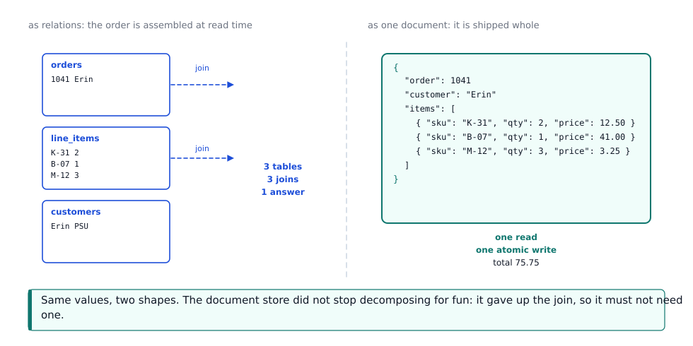{width="90%"}

The defining property of a document store is **not** the format. It is that a
whole nested structure is **one addressable, atomically mutable value** — this
order, three line items and all, totalling `75.75`, in one read and one write.

And the structural reason is the one from slide 11: you gave up the join, so
you gave up reassembling a relation at read time. The document store's answer
is **do not decompose in the first place**.

::: {.notes}
Insist on "not the format". JSON is a serialisation choice; the aggregate is
the design choice, and it is the one that follows from the missing join.

Examples they already know: a user profile with embedded addresses, an order
with its line items, a product with variants.
:::

## The commit point moved into the document {.smaller}

The mechanism

Document databases did not abandon ACID. They **moved the commit point to the
document**: a single-document write is atomic and usually durable.

What you lose is **cross-document** atomicity — unless the system added it
later, at a price. The design rule that follows is short:

> **If two pieces of data must be updated atomically, they belong in the same
> document.**

And the failure mode is worth naming: if the boundary is wrong, you find out
when you need a multi-document transaction — and at that point you are running
a document database as a worse relational database.

::: {.notes}
This is the single most useful sentence in the lecture for somebody about to
design a schema: the aggregate boundary is the transaction boundary, and you
get one chance to get it right.

Most production document-store pain traces back to this one decision, made
early, for the wrong reason.
:::

## "Schemaless" means the schema moved into the application {.smaller}

The bill

| | schema-on-write | schema-on-read |
|---|---|---|
| who checks the shape | the database, at insert | the application, on read |
| malformed data | rejected | stored |
| a change of shape | a migration | a code path |

The tell that this is a real cost: every mature document store re-added
validation. CouchDB has `validate_doc_update` functions that run on write and
reject by throwing.

What you actually get is **schema drift**: several historical shapes coexisting
in one collection, with the compatibility logic living in the application.

::: {.notes}
"Schemaless" describes the absence of a *centralised* constraint, not the
absence of structure. The structure is in the code that reads the documents.

Schema drift is the cost that shows up in month six, when nobody remembers
which of the three shapes a document has.
:::

## One data model, three coordination choices {.smaller}

The trade

| | coordination | consistency | what it proves |
|---|---|---|---|
| **HBase** | master and region servers, on HDFS | strong by default | the model does not force AP |
| **Cassandra** | leaderless, quorum per query | a dial | the model does not force strong |
| **Riak** | leaderless, no quorum | CRDTs merge | convergence without agreement |

All three are wide-column. They sit on opposite sides of the fork. **The data
model does not pick the consistency choice** — and that is the most useful
thing the family can teach.

Riak is also the third answer to divergence: not quorum, not a revision tree,
but **data types that merge**.

::: {.notes}
This is where the four wide-column slides compress into one. HBase and
Accumulo are CP; Cassandra is AP with a dial; Riak is AP with mergeable types.

If a student thinks "wide-column means eventually consistent", this slide is
the correction.
:::

## CouchDB: replication is the primary constraint {.smaller}

The evidence

::: {.steps style="height:470px"}

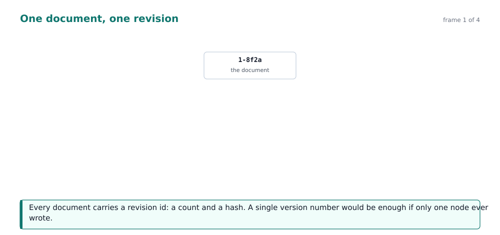

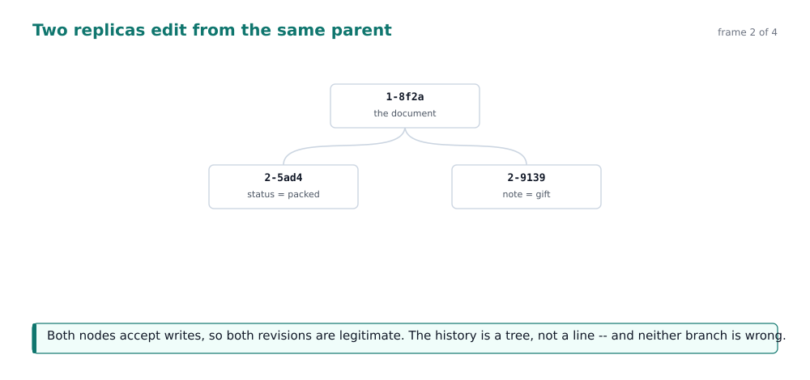{.fragment}

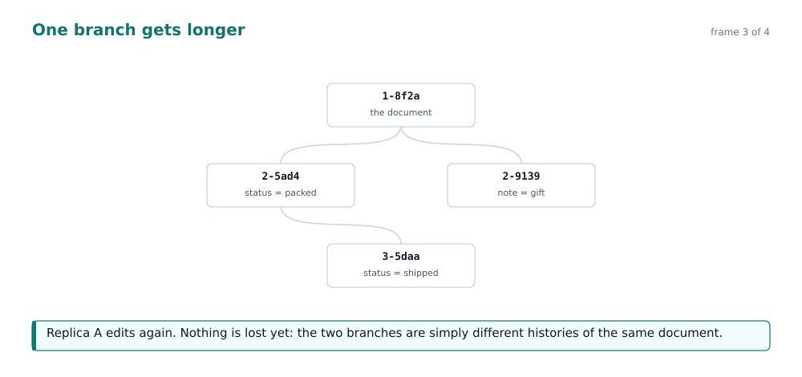{.fragment}

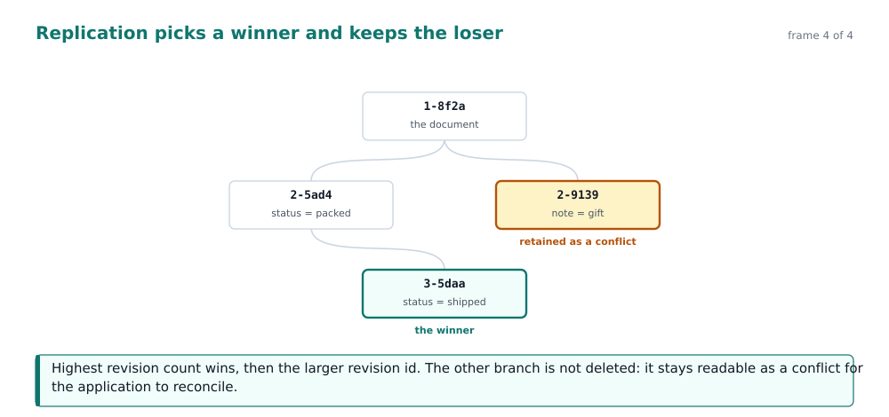{.fragment}

:::

Every replica accepts writes; replication is pairwise, resumable and
bidirectional, with **no primary**. Because concurrent edits are normal, a
document carries a **revision tree**, not a version number — and the loser of a
merge is **retained**, not deleted, and readable as a conflict.

PouchDB is the same protocol in a browser: the client is a genuine replica, not
a cache.

::: {.notes}
The payoff of the four frames is the last one: nothing is silently lost. A
system that can tell you "here are the two histories and which one I picked"
is doing something a version number cannot.

PouchDB matters because a self-contained document has no referential integrity
to violate. Syncing an aggregate is merging an aggregate; syncing a row risks a
dangling foreign key.
:::

## RavenDB: ACID documents, eventual indexes {.smaller}

The evidence

The honest counterexample to "documents cannot do ACID". RavenDB provides
**multi-document transactions by default**, not as an opt-in bolt-on.

And then the second, more interesting decision: **its indexes are
non-transactional and eventually consistent by design.**

| | consistency | what it means |
|---|---|---|
| the documents | strong | a transaction is a transaction |
| a query served from an index | eventual | it may not see the write you just committed |

RavenDB decomposes consistency into **document consistency** and **index
freshness**. That is a genuinely different decomposition, and it is worth
knowing that somebody made it.

::: {.notes}
This slide exists to keep the deck honest. The narrative wants "documents trade
away ACID"; RavenDB shows a document store that did not.

The decomposition is the interesting part: it is the same move as Cassandra's
per-query dial, but split along a different seam — write path versus read path,
rather than one operation at a time.
:::

## The shape that refuses to give up the join {.smaller}

The evidence

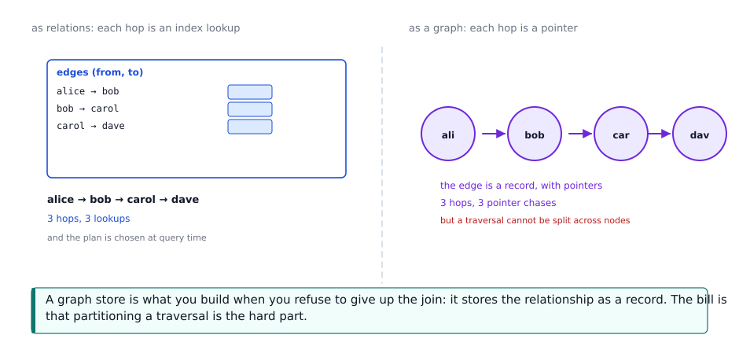{width="92%"}

A graph store is what you build when the join is the thing you will not give up.
**Index-free adjacency** stores the relationship itself as a record holding
pointers, so a traversal is a pointer chase rather than a series of index
lookups.

The join is **materialised at write time**. The bill: a traversal crosses
partitions by nature, so partitioning a graph is the hard part, and deep
traversal does not scale out the way a partition-key read does.

::: {.notes}
Neo4j is the example, and it earns a slide because it answers the lecture's
question with a fourth option: keep the join, keep the commit point on one
node, and make the traversal cheap instead.

Note the symmetry with slide 20. Cassandra materialises the join into extra
tables; a graph store materialises it into pointers. Both are paying at write
time for a read-time problem.
:::

## An index is a bet about the next query {.smaller}

The mechanism

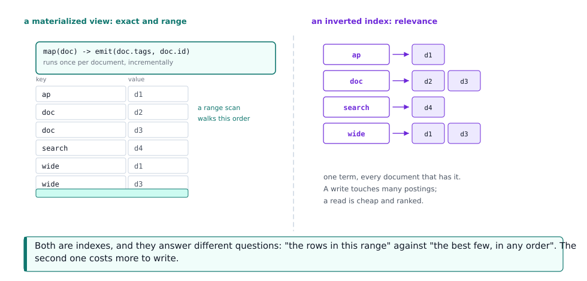{width="92%"}

A CouchDB view is an **incrementally maintained materialised view**: a `map`
function runs over every document, its output is sorted into a persistent
B-tree, and queries are range scans over that order.

An inverted index answers a different question: **term to postings**, optimised
for "the best few, in any order". A write touches many postings, so writes are
expensive and reads are flexible — the inverse of the wide-column model.

Both are bets that the next query looks like the last one.

::: {.notes}
The point of putting them together is that both are *precomputed answers*, and
both are wrong for questions nobody anticipated. That is the same discipline as
"design the table around the query", expressed two different ways.

The write-cost asymmetry is the practical bit: an inverted index is a bad
primary store for that reason.
:::

## Blob is the floor, not the destination {.smaller}

The bill

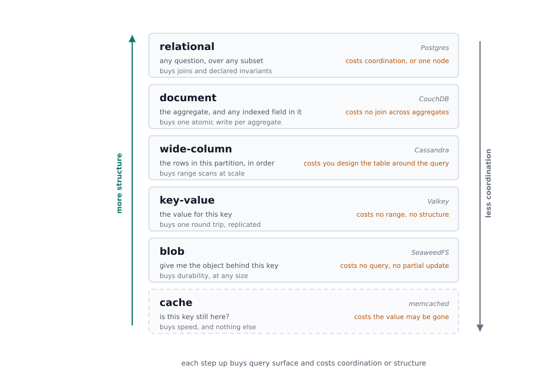{width="84%"}

A blob store maps `(bucket, key)` to an **opaque byte sequence**. The value is
never queried or indexed, only stored and retrieved whole, and a partial update
is usually impossible — you replace the object.

That is not a failure. It is the correct design for backups, media and
data-lake payloads. But it is also the bottom of a **spectrum of access depth**,
and every step up buys query surface and costs coordination or structure.

::: {.notes}
Walk the ladder from the bottom: cache, blob, key-value, wide-column, document,
relational. The audience has now met every rung, which is why the figure has a
system named on each one.

The design question to leave them with is not "how do we get to blobs" but "how
much structure do we keep, and where does the transaction boundary sit".
:::

## Below the blob is a value that may not be there {.smaller}

The bill

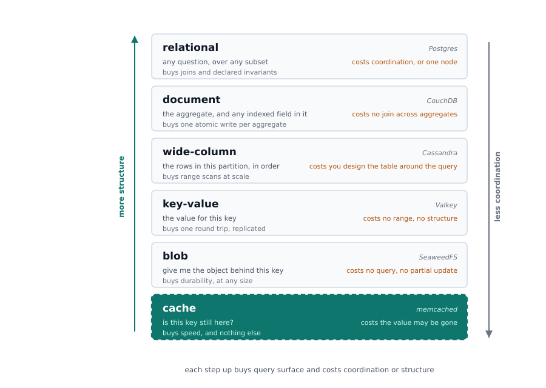{width="84%"}

The cheapest answer to "where is the commit point" is **there isn't one, and
there was never a promise**. That is `memcached`: no durability, no
replication, no transactions. The client hashes a key to a server, and the
entry can vanish.

`Valkey` sits one rung up and is the more instructive case: **one node holds
the commit point**, replicas are asynchronous, so a failover can lose a write —
and `WAIT` is the quorum dial at miniature scale.

**A cache is not a degenerate database. It is a deliberate refusal to promise
something it would have to keep.**

::: {.notes}
Both of these belong on the ladder rather than in a tour of their own. The
point is not what memcached does; it is that "no promise" is a legitimate
position on the axis the lecture has been using all along.

Valkey is the one they will have used, and it is the smallest complete example
of the fork from slide 8: async copies, a weak dial, and a real data-loss
window on failover.
:::

# Part VI — The Capstone

## Distributed ACID is possible if you pay coordination on every commit {.smaller}

The turn

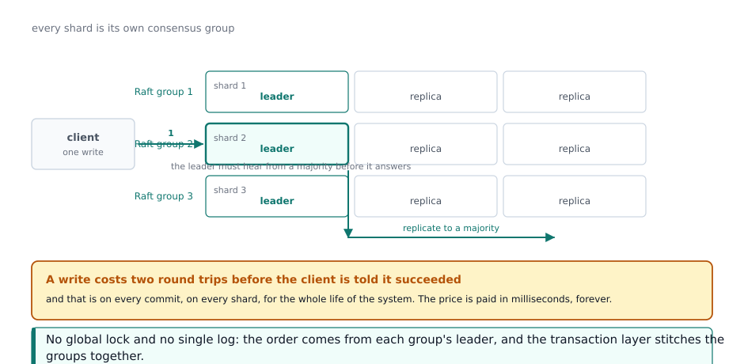{width="90%"}

**YugabyteDB** and **TiDB** do the thing slide 7 said was "virtually
impossible": they keep serializable-ish transactions across machines. The trick
is not a better algorithm, it is **paying the price consistently**:

- split the data into shards (ranges or tablets)
- make each shard a consensus group with a leader
- commit across shards with two-phase commit
- get the order from a timestamp authority

That is two round trips before the client is told the write succeeded — on
every commit, for the life of the system.

::: {.notes}
Note the shape: every piece of this is something the earlier slides already
introduced. Raft is the eager path from slide 7. Two-phase commit is what you
do when the decision spans shards. The new thing is only that they accept the
cost on every single commit.

CockroachDB used to be the obvious example here. Its licence moved, which is
why it is not on this slide — and why slide 41 exists.
:::

## The commit point came back, but not to the same place {.smaller}

Where the order comes from

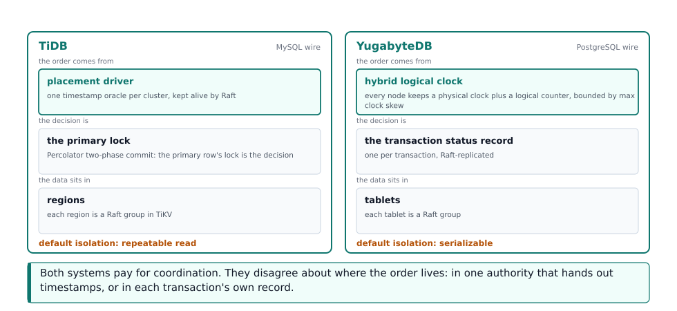{width="92%"}

Both systems pay for coordination. They disagree about **where the order
lives**:

- **TiDB** asks one authority for a timestamp, and the decision is the primary
  lock of a two-phase commit. The order comes from **outside** the transaction.
- **YugabyteDB** orders writes with a hybrid logical clock and records one
  status per transaction. The order comes from **inside** it.

Same question as slide 5 — where does the order come from? — and two different
answers.

::: {.notes}
This is the slide the whole lecture has been earning. Point at the highlighted
box in each panel: that is the commit point, rebuilt, in two places.

Worth saying out loud: they also differ on the default isolation level, which
is the next slide and the reason the precision beat pays off.
:::

## "ACID" here still means a point on a spectrum {.smaller}

The claim

YugabyteDB defaults to **serializable**. TiDB defaults to **repeatable read**,
because it is MySQL-compatible and that is what MySQL means.

Both "pay for ACID" and still disagree about what it buys — which is exactly
what Part IV said would happen: there is no monolith, only **a specific point
in a spectrum of guarantees**.

And the currency is still the same one:

what it buys

ACID transactions, horizontal scale and geo-replication in one system.

what it charges

A round trip on every commit, and two more distributed components to operate.

::: {.notes}
The loop back to Part IV is the point of the slide: two systems that both claim
to pay for ACID, disagreeing about the isolation level, is the argument that
"ACID" is a spectrum made concrete.

Do not oversell: repeatable read is not a defect, it is a compatibility
decision. But it is a different guarantee, and the deck's whole habit is to
name the guarantee rather than the adjective.
:::

# Part VII — The Meta

## The systems you can study are the systems you can run {.smaller}

The claim

There is a pattern, and you have already watched it once this hour.

- **The bait.** Open core until the cloud provider arrives, then the licence
  moves. Elasticsearch became OpenSearch, Redis became Valkey, and the fork is
  the same fork twice.
- **The free sample.** Oracle's catalogue is the oldest version of this:
  MySQL, Berkeley DB, Java. Free to learn on, expensive to build on, and the
  interesting internals sit behind a support contract. **Do not take even the
  free samples from Oracle.**
- **The tell.** A managed service can be excellent and still be unlearnable.
  You cannot read the code, so its "design trade-off" is a marketing claim
  rather than a fact you can check.

Every diagram in this lecture came from documentation and source you can read.
That is not a neutral fact about the software market. It is a fact about which
part of the market you can learn from.

::: {.notes}
This is the payoff for the promise made on slide 1, and it is the only place in
the lecture where a licence is mentioned. Do not let it become a second slide.

The concrete instance is the deck's own composition: CockroachDB was the
obvious capstone example until its licence moved, so it left. That is the
argument, and it is stronger than any assertion.
:::

# Wrap

## The design space, in one picture {.smaller}

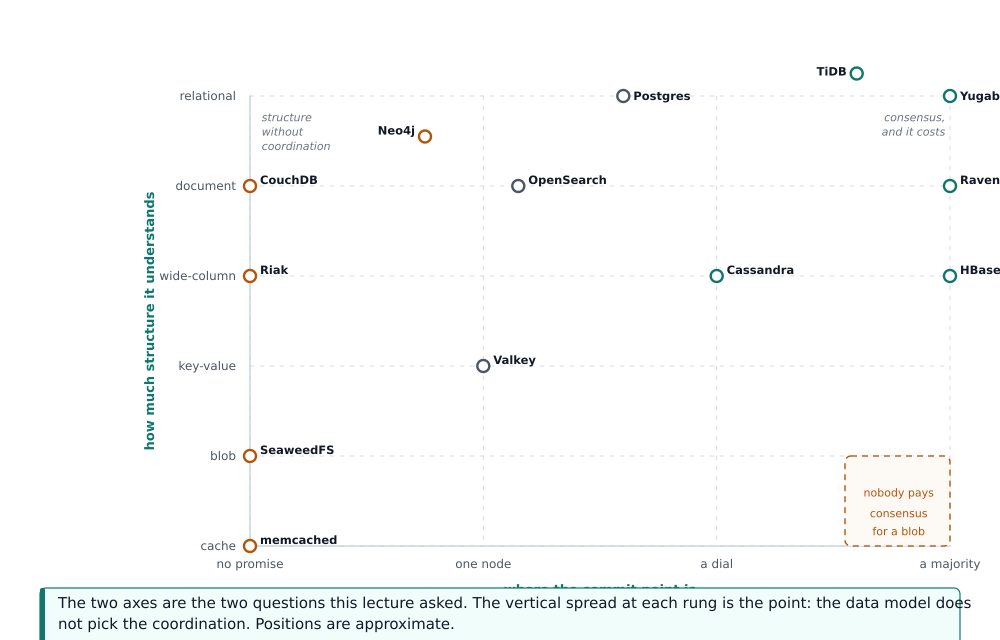{width="88%"}

The two axes are the two questions this lecture asked: **where the commit point
is**, and **how much structure the store understands**.

Read the vertical spread: at almost every rung there are systems on both sides
of the fork. That is the claim the whole lecture has been building — the data
model does not pick the coordination. And note the empty corner: **nobody pays
consensus for a blob.**

::: {.notes}
This is the slide to photograph, and the one to leave on screen while they
pack up.

The empty corner is the observation a list of products cannot give you. It is
worth asking why it is empty: because there is no query to make consistent, so
there is nothing to pay for.
:::

## Five things to remember {.smaller}

1. **ACID is cheap because one node owns the commit point**, and that is the
   thing that does not distribute.
2. **`W + R > N` is the whole dial** — strong consistency without a master, at
   an explicit price.
3. **The join is what pays for sharding**, and losing it loses the machinery
   that made "C" checkable.
4. **"Partially ACID" is not a category.** Name the guarantee and its scope.
5. **The document is an aggregate, not a format** — the commit point moved, it
   did not disappear.

::: {.notes}
If they remember one, make it number 4, because it is the habit: name the
guarantee, name its scope, and the marketing stops working.

If they remember two, make the second number 1 — one commit point, one node,
one reason it is hard to distribute.
:::

## Where this goes {.smaller}

- **This lecture** was about one question and the five answers to it.
- **What it did not cover:** streams (the commit point is an offset), vector
  stores (a blob with one index bolted on), and time series (wide-column with
  time as the clustering key). Each is a shape or a variation; none changes the
  question.
- **For the project:** the default is still Postgres, and now you can say why.
  Reach for something else when you can name the cost you are choosing to pay.

::: {.notes}
Name what was left out, so its absence reads as a judgement rather than an
omission. All three are one sentence each if somebody asks.

The last line is the honest advice for a term project: Postgres plus JSONB is
the right answer for most of what they will build, and the value of the lecture
is that they can now defend that choice instead of defaulting to it.
:::
